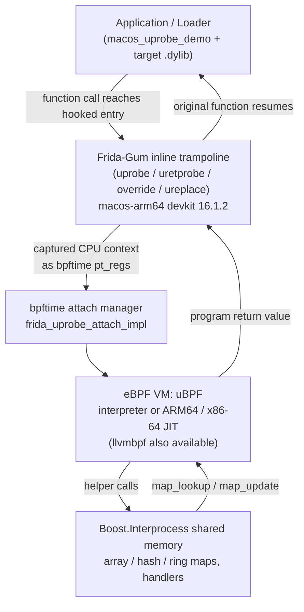

# Running Userspace eBPF & Dynamic Uprobes on macOS (Apple Silicon) with bpftime

This example is a complete, self-contained demonstration that eBPF programs
and dynamic function tracing run **natively on macOS** — on Apple Silicon,
with System Integrity Protection (SIP) enabled, without root, without a kernel
extension and without disabling any platform security feature. It builds and
runs unchanged on Linux x86-64/aarch64 as well.

The demo attaches a `uprobe` and a `uretprobe` to a function exported by a
separate shared library (`.dylib` / `.so`), runs two hand-written eBPF
programs on the uBPF interpreter or JIT, accumulates arguments and return
values in a shared-memory array map, detaches the probes dynamically and
verifies that tracing stops — all through the in-process bpftime API.

## Why userspace eBPF on macOS matters

### The platform constraints

Linux observability is built on kernel facilities that do not exist on Darwin:

- **XNU has no Linux eBPF subsystem.** There is no kernel verifier, no
  `bpf(2)` syscall and no kernel-side map or helper infrastructure.
- **SIP restricts the classic tracers.** DTrace on macOS runs in a restricted
  mode: tracing platform binaries and many production processes is blocked or
  stripped, kernel probes are unavailable, and `task_for_pid` against other
  processes requires entitlements that ordinary developer accounts do not hold.
- **Kernel extensions are effectively closed.** Modern macOS only loads
  System Extensions / Endpoint Security extensions signed with special Apple
  entitlements; a kext-based tracer is not an option for most teams.

### What bpftime does instead

bpftime moves the entire eBPF execution model into **user space**:

- eBPF bytecode is verified and executed inside the traced process itself by
  an embedded VM (uBPF, with an ARM64 JIT on Apple Silicon), instead of being
  loaded into a kernel.
- Function probes are installed as **in-process inline hooks** through
  [Frida-gum](https://frida.re/), which writes trampolines into writable
  memory pages of the calling process — an operation every process may perform
  on its own memory under the hardened runtime.
- Maps and handler state live in **Boost.Interprocess shared memory**, mapped
  into the process address space, with no kernel dependency.

Because everything happens inside your own process, the usual blockers
disappear:

| Requirement | Kernel eBPF / DTrace approach | bpftime userspace approach |
| --- | --- | --- |
| Disable SIP | Often required for unrestricted tracing | **Not required** |
| Kernel extension / special entitlement | Required for new kernel agents | **Not required** |
| `sudo` / root | Required for kernel probes and `task_for_pid` | **Not required for self-tracing** |
| Reboot | Sometimes (kext loading, SIP changes) | **Not required** |
| Works inside containers / restricted CI | Limited | Runs as a normal build artifact |

The trade-off is scope: this model traces the process you control. Tracing an
unrelated, already-running system daemon remains governed by the platform's
`task_for_pid` rules and SIP — see [SIP boundary](#sip-boundary).

## Architecture and data flow



The same path in plain text, for a single call to
`bpftime_macos_demo_compute(a, b)`:

1. The application calls the target function. Frida-gum's entry trampoline
   saves the CPU register state and builds a `pt_regs` structure using the
   platform ABI.
2. The trampoline dispatches into `frida_uprobe_attach_impl`, which looks up
   the eBPF program attached to that address and invokes the VM.
3. The uBPF VM executes the bytecode. The `uprobe` program reads the first
   argument from `pt_regs`, calls `bpf_map_lookup_elem` /
   `bpf_map_update_elem` against the shared-memory array map, increments the
   call counter and accumulates the argument. On function return the
   `uretprobe` program accumulates the return value the same way.
4. Control returns through the trampoline; the target function executes
   normally and its result is unchanged (this demo uses observability-only
   probes; `override` / `ureplace` can modify arguments and returns instead).
5. When the links are destroyed, Frida-gum restores the original instructions
   and subsequent calls incur no hook overhead.

### Process topology

Everything lives in one process — the statically linked `libruntime.a`
(handler manager, shared-memory maps and per-CPU guard), the uBPF VM, the
Frida-gum library and the hooked target shared library. There is no daemon,
privileged helper or second process; the preload/agent topology
(`DYLD_INSERT_LIBRARIES` / `LD_PRELOAD`) used elsewhere in the project is
covered in the roadmap.

## Darwin platform mechanisms

Four platform differences required explicit handling. Each is isolated behind
an `__APPLE__` guard so the Linux code path is unchanged.

### 1. Per-logical-CPU execution guard: `pthread_cpu_number_np`

Some eBPF helpers assume a stable "current CPU" index, and bpftime keeps a
per-thread BPF CPU plus an affinity-style mask. The initial Darwin port called
`sysctlbyname("hw.cpulocation", ...)`, a name that **does not exist in XNU**:
the call always failed with `ENOENT`, the CPU id stayed `-1`, and the
execution guard rejected every program that touched shared memory with
`-EAGAIN`.

The supported replacement is the pthread non-portable API:

```cpp
size_t cpu = 0;
if (pthread_cpu_number_np(&cpu) != 0) /* fail closed */;
```

It returns the logical CPU number of the calling thread (range `[0, hw.ncpu)`),
is available since macOS 11.0 and is exported by libSystem, so no extra link
flag is needed. The affinity shim additionally guards `CPU_SET` against a
negative index — the Darwin `cpu_set_t` is a small integer shim where
`CPU_SET(-1, ...)` would otherwise be an undefined negative shift.

### 2. Module resolution: dyld image names and the main executable path

On Linux, `dl_iterate_phdr` reports the main executable under the empty module
name `""`, and the attach layer normalizes executable-relative probes to that
empty name. Darwin's dynamic loader (`dyld`) and Frida-gum's Darwin backend
instead identify every image — including the main executable — by its **full
path**. Passing `""` to `gum_module_find_base_address` or
`gum_module_enumerate_ranges` returns nothing, so main-executable probes
failed to resolve.

The fix maps the empty name to `get_executable_path()` (resolved with
`proc_pidpath`) inside the three module helpers under `__APPLE__`. Module
existence validation likewise cannot read `/proc/self/maps` (and must not use
the GNU `%ms` `sscanf` extension); it walks the dyld image list instead:

```cpp
for (uint32_t i = 0; i < _dyld_image_count(); ++i) {
    const char *img = _dyld_get_image_name(i);
    if (module == img || std::filesystem::equivalent(module, img))
        return true; // handles /tmp -> /private/tmp style symlinks
}
```

### 3. W^X memory protection and the ARM64 register ABI

Apple enforces strict page permissions: a page is never simultaneously
writable and executable. Frida-gum handles this by allocating trampolines on
pages it switches between `RW` and `RX` with `vm_protect`, respecting the
hardened runtime. Application code does not touch these flags directly.

The eBPF programs read arguments and return values from a `pt_regs` shim whose
layout follows the kernel `bpf_tracing.h` conventions for each architecture:

| Field | arm64 (Apple Silicon) | x86-64 |
| --- | --- | --- |
| First argument (`PT_REGS_PARM1`) | `regs[0]` (x0) | `di` |
| Return value (`PT_REGS_RC`) | `regs[0]` (x0) | `ax` |

The demo computes both offsets with `offsetof(pt_regs, ...)` and embeds them in
the same eBPF bytecode, so one program source runs correctly on both
architectures — the only per-arch difference is two compile-time constants.

### 4. Shared memory without POSIX shm: Boost.Interprocess on Darwin

macOS does not implement POSIX shared memory objects (`_POSIX_SHARED_MEMORY_OBJECTS`
is undefined), so there is no `/dev/shm`. Boost.Interprocess transparently
falls back to **memory-mapped files under `/tmp/boost_interprocess/`**, named
after the segment. The example and its test driver therefore:

- count open file descriptors through `/dev/fd` instead of `/proc/self/fd`;
- assert cleanup against `/tmp/boost_interprocess/<name>` instead of
  `/dev/shm/<name>`;
- give every run a unique segment name (`bpftime-macos-demo-<pid>-<clock>`)
  and remove it in the RAII cleanup path, leaving the directory empty after a
  successful run.

## Quick start on macOS

Prerequisites (Apple Silicon, macOS 11 or newer — tested on macOS 26.x with
SIP enabled):

```sh
brew install cmake ninja boost
git submodule update --init --recursive
```

Configure and build. The Frida macOS ARM64 devkit is downloaded automatically
and checksum-verified by the build system:

```sh
cmake -S . -B build-macos -G Ninja -DCMAKE_BUILD_TYPE=Release \
  -DBPFTIME_BUILD_WITH_LIBBPF=OFF \
  -DBPFTIME_LLVM_JIT=OFF \
  -DBPFTIME_UBPF_JIT=ON \
  -DBPFTIME_ENABLE_FRIDA=ON \
  -DBPFTIME_ENABLE_CUDA_ATTACH=OFF \
  -DBUILD_BPFTIME_DAEMON=OFF \
  -DBPFTIME_BUILD_RUNTIME_LIBRARY_EXAMPLE=ON \
  -DBPFTIME_BUILD_MACOS_EXAMPLE=ON \
  -DBPFTIME_ENABLE_UNIT_TESTING=ON \
  -DENABLE_EBPF_VERIFIER=OFF

cmake --build build-macos --target macos_uprobe_demo
```

Run it directly (no `sudo`):

Illustrative output (the absolute module path and symbol offset vary with
the build layout and toolchain):

```sh
$ ./build-macos/example/macos/macos_uprobe_demo jit
target module=/.../build-macos/example/macos/libbpftime_macos_demo_target.dylib symbol_offset=0xf76c mode=jit
calls=100 arg_sum=5050 ret_sum=50800
macos_uprobe_demo jit: PASSED (attach, exact maps, detach, cleanup)
```

`arg_sum=5050` is `1+2+...+100`; `ret_sum=50800` is the sum of
`i*10+3` over the same range. The first argument selects `interpreter` or
`jit` (default `jit`); the optional second argument sets the iteration count.

Run the full gate through CTest — the same command the CI workflow uses:

```sh
ctest --test-dir build-macos \
  -R '^(runtime_library_|macos_uprobe_demo_|bpftime_frida_uprobe_attach_tests$)' \
  --output-on-failure
```

Expected result on Apple Silicon: all suites pass, including the 17-case
Frida uprobe attach suite (1067 assertions) and both `macos_uprobe_demo`
modes.

The identical CMake configuration and CTest command work on Linux x86-64 and
aarch64, where the target is a `.so` and the bytecode uses the x86-64 or
arm64 `pt_regs` offsets automatically.

## File layout

| File | Role |
| --- | --- |
| `target.cpp` | The traced function, built as a standalone shared library; `noinline` and default-visible so the symbol always exists |
| `main.cpp` | SHM/RAII session, map and eBPF program creation, `dladdr` resolution, uprobe/uretprobe attach, exact-value verification, dynamic detach and leak checks |
| `CMakeLists.txt` | Shared-library + executable targets, uBPF object retention, build-tree rpath, two CTest registrations |

## Capabilities, SIP boundary and roadmap

### What works natively today

- Full userspace map set in shared memory (array, hash, ring buffer and more)
  with deterministic create/destroy semantics.
- uBPF **interpreter and JIT** on ARM64 (Apple Silicon) and x86-64.
- Frida-gum `uprobe`, `uretprobe`, `uprobe override` and `ureplace`, covered
  by an in-tree 17-case test suite.
- `bpftimetool`, the direct `runtime_library` embedding example and this
  cross-platform dynamic uprobe demo, all verified by CTest on macOS and Linux.

### SIP boundary

Self-tracing — a process instrumenting its own code and libraries loaded into
it — runs unprivileged with SIP on. Instrumenting a **different** process is
subject to macOS code-signing and `task_for_pid` rules, and platform binaries
under `/usr/bin` and the sealed system volume are additionally protected by
SIP; those boundaries are owned by the OS and are not bypassed by bpftime.
The practical guidance is the same as for any user-space tracer on macOS:
distribute instrumentation inside your own application, test build or
in-house build of a third-party component.

### Roadmap

Directional next steps, not current capabilities:

- **`libbpftime-agent.dylib` injection**: package the runtime for
  `DYLD_INSERT_LIBRARIES`, mirroring the Linux `LD_PRELOAD` agent so
  unmodified applications can be traced without relinking.
- **Mach-O USDT activation**: resolve User Statically Defined Trace probes in
  `__DATA,__dof` sections, the Mach-O counterpart of ELF USDT notes.
- **Tooling parity**: run bpftrace-style scripts and libbpf-tools workloads
  (`sslsniff`, `malloc`, `funclatency`, …) on the userspace VM in macOS.
- **System extension path**: evaluate an Endpoint Security / System Extension
  package for teams that need cross-process tracing under managed Apple
  deployments.
